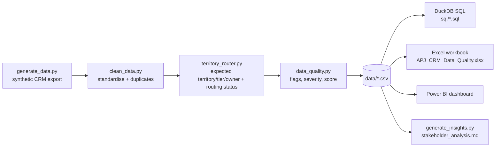

# APJ Revenue Operations & Territory Management System

> A realistic Revenue Operations case study: territory assignment, account routing and CRM data quality for a **fictional** B2B SaaS company selling across 11 APJ countries.
> **All data is synthetic.** No real customers, companies, people or CRM exports are used, and no paid tools or APIs are required.

## Business Problem

The APJ sales organisation of a fictional B2B SaaS company manages ~5,000 customer and prospect accounts across India, Australia, New Zealand, Singapore, Japan, South Korea, Indonesia, Malaysia, Thailand, the Philippines and Vietnam.
Revenue Operations is accountable for getting every account to the right owner, keeping CRM data trustworthy, and giving sales leadership reliable territory and pipeline reporting.

In practice the CRM drifts: accounts are created without owners, territories get hand-edited, duplicates arrive from imports, and headcount/country fields go missing. Left alone, this causes uncovered pipeline, wrong-rep outreach and numbers leadership cannot trust.

## Solution

An end-to-end, reproducible RevOps workflow:

1. **Generate** a messy synthetic CRM export (with deliberately injected, realistic problems).
2. **Clean & standardise** it, flagging (never deleting) duplicates.
3. **Route** every account with a deterministic rules engine and classify exceptions.
4. **Score data quality** with documented severities and a transparent scoring model.
5. **Analyse** with DuckDB SQL, an auditable Excel workbook and a four-page Power BI report.
6. **Document** the process: territory rules, routing logic, an operations runbook and stakeholder analysis.

## Architecture



## Technology Stack

Python 3 (pandas, numpy) | DuckDB (SQL) | Excel via openpyxl (XLOOKUP, VLOOKUP, IFS, COUNTIFS, SUMIFS, conditional formatting) | Power BI Desktop | Git/GitHub. All free. **No machine learning** - business rules only.

## Synthetic Dataset

* Generated by `python/generate_data.py` with a fixed seed (`20260930`) and a fixed as-of date (2026-09-30) - the data is identical on every run.
* 5,000 accounts, 4,255 opportunities (1,895 open, $97.3M open pipeline), 11 countries mapped to 5 territories.
* Company names are algorithmically invented; any resemblance to a real organisation is coincidental. Domains use real country TLDs for validation realism and are not real customer data.

**Injected CRM problems** (rates in the delivered dataset):

| Problem | Target | Delivered |
|---|---|---|
| Duplicate accounts | ~2% | 100 injected (2.0%); 97 caught by the detector |
| Missing country | ~3% | 3.0% |
| Missing employee count | ~2% | 1.8% |
| Missing annual revenue | ~2% | 2.0% |
| Missing account owner | ~2% | 2.1% |
| Stale accounts (> 180 days) | ~3% | 2.7% |
| Wrong territory | 1-2% | 1.4% |
| Invalid / missing domain | some | 2.7% |
| Accounts without an open opportunity | some | 62% |

Also injected: non-standard country spellings (`AU`, `Korea`), invalid country values (`APAC`), tier drift, invalid territory labels, and opportunities with a stage but no value.

**Seeded business patterns** (so the analysis has something real to find - disclosed, not hidden): India accounts created since April 2026 have a much higher missing-owner rate (simulating a rep vacancy); Japan has a higher stale rate; SEA/Korea have higher wrong-territory rates.

## Territory Model

| Territory | Countries | Owner |
|---|---|---|
| India | India | Priya Sharma (Enterprise), Arjun Mehta (Commercial) |
| ANZ | Australia, New Zealand | James Wilson |
| SEA | Singapore, Indonesia, Malaysia, Thailand, Philippines, Vietnam | Daniel Lim |
| Japan | Japan | Yuki Tanaka |
| Korea | South Korea | Min-Jun Park |

Tiers by `Employee_Count`: Enterprise >= 5,000 | Mid-Market 500-4,999 | SMB < 500. Details: [`documentation/territory_rules.md`](documentation/territory_rules.md).

## Account Routing

`python/territory_router.py` applies ordered, deterministic rules and assigns each account one of five statuses:

| Status | Accounts |
|---|---|
| Correctly Routed | 4,464 |
| Incorrectly Routed | 90 |
| Unassigned | 161 |
| Ambiguous (country missing/invalid) | 162 |
| Manual Review (duplicates, missing India headcount) | 123 |

**Routing Accuracy = Correctly Routed / (Correct + Incorrect + Unassigned) = 94.7%** on 4,715 routable accounts. Rule order and rationale: [`documentation/routing_logic.md`](documentation/routing_logic.md).

## CRM Data Quality

`python/data_quality.py` runs 12 checks (duplicates, missing country/revenue/owner/employee/territory, invalid country/territory/domain, stale, tier mismatch, missing opportunity info), each with a severity and a recommended action.

**Scoring model**

* Record score = `100 - penalties` (Critical 40, High 25, Medium 10, Low 5), floored at 0.
* **Data Quality Score %** = average record score = **94.7%**.
* **Clean Record Rate** = share of records with no issues = **79.7%** (the score is deliberately paired with this stricter view).
* Status = worst severity on the record: Good 3,987 | Warning 446 | Needs Review 209 | Critical 358.

## SQL Analytics

34 DuckDB queries across four files in [`sql/`](sql): territory, pipeline, data-quality and routing analysis. Run them with:

```bash
python python/run_sql.py                      # all files
python python/run_sql.py sql/routing_analysis.sql --export
```

## Excel Analysis

`excel/APJ_CRM_Data_Quality.xlsx` (6 sheets: Raw Accounts, Clean Accounts, Territory Mapping, Data Quality, Routing Exceptions, Pivot Analysis). Live formulas: `XLOOKUP`, `VLOOKUP`, `IFS`, `IF`, `COUNTIF(S)`, `SUMIF(S)`, `AVERAGEIFS`, COUNTIF-based duplicate detection, filters, conditional formatting and a chart.
Requires **Excel 2021 / Microsoft 365** (XLOOKUP, IFS). The Pivot Analysis sheet uses formula-built pivot-style tables, with steps to insert a native PivotTable. The workbook KPIs reconcile exactly to the Python and SQL outputs.

## Power BI Dashboard

Four pages - Executive Overview, Territory Performance, CRM Data Quality, Routing & Exceptions. Step-by-step build guide with the data model, DAX measures and every visual: [`powerbi/README.md`](powerbi/README.md). Add your screenshots from [`screenshots/`](screenshots/README.md) here:

```

```

## Business Insights

All computed from the data by `python/generate_insights.py` (full write-up, evidence and recommended actions in [`documentation/stakeholder_analysis.md`](documentation/stakeholder_analysis.md)):

1. **SEA** holds the largest open pipeline - $31.8M of $97.3M (32.6%).
2. **Japan** has the weakest data quality (score 95.8%, 80.6% clean records) and the largest stale-account problem (5.7% vs 2.7% portfolio).
3. **SEA** has the most routing exceptions (124), but **India** has the highest rate (9.9 per 100 accounts).
4. **12 of 329 Enterprise accounts are unassigned**, and Enterprise is 31.2% of pipeline from 6.6% of accounts.
5. **$5.3M of open pipeline (5.5%)** sits on accounts with no valid owner/territory; **286 open opportunities ($16.4M)** are stale.
6. India coverage on accounts created since April 2026 is **88.0% vs 96.3%** for older accounts - a new-account assignment gap.

## Operational Runbook

A recurring weekly cycle - CRM export > validation > duplicate detection > DQ checks > territory assignment > routing validation > exception review > dashboard refresh > stakeholder reporting > issue documentation - with inputs, outputs, quality gates, escalation rules and a resolution process: [`documentation/runbook.md`](documentation/runbook.md).

## Project Outcomes

What this project produces (not claims about a real business):

* A reproducible pipeline that turns a messy export into a routed, scored, analysis-ready dataset in seconds (`python python/run_all.py`).
* A routing engine that finds 536 exceptions across 4 status categories and 9 exception types and a prioritised work-queue (High / Medium / Low) with a workflow status for each.
* One consistent set of KPIs across Python, SQL and Excel (reconciled), ready for Power BI.
* Documentation another analyst could pick up and run: rules, logic, data dictionary, runbook and stakeholder answers.

## Limitations

* Synthetic data: distributions are plausible, not empirical; seeded patterns make findings easier to see than in real data.
* Not connected to a live CRM (no Salesforce or other CRM access is claimed); the pipeline works on exports.
* One rep per territory (two in India) - no capacity, quota or round-robin logic.
* Exception `Resolution_Status` is a derived workflow state; the data contains no completed resolutions or history.
* Duplicate detection is rule-based (domain / normalised name + country) and misses duplicates that lack both.
* The Excel "Pivot Analysis" sheet is formula-driven, not a native PivotTable.
* The SQL was validated against an in-memory SQLite engine during development and is written in portable SQL for DuckDB; the Power BI guide was not click-tested in Power BI Desktop.

## Future Improvements

* Weekly snapshots to track coverage and DQ score trends over time.
* Fuzzy matching for duplicates; a scheduled job and email summary.
* Capacity-aware routing (accounts per rep) and named-account lists.
* Lead-to-account matching and a routing-SLA metric (time to assignment).
* Automated tests (pytest) for each rule.

## What This Project Demonstrates

* **Revenue Operations** - building the operating rhythm around CRM, territory and reporting.
* **Territory Management** - defining territories, segments and ownership rules, and measuring coverage.
* **CRM Operations** - modelling accounts, opportunities and owners; spotting how CRM data drifts.
* **Account Routing** - deterministic rules, exception classes and routing-accuracy measurement.
* **Data Quality** - automated checks, severity model, scoring and prioritisation by impact.
* **Sales Analytics** - pipeline by territory, country, tier and stage; stale pipeline; win rate.
* **SQL** - 34 DuckDB queries (window functions, FILTER aggregates, joins, CASE logic).
* **Excel** - XLOOKUP, VLOOKUP, IFS, COUNTIFS, SUMIFS, conditional formatting, duplicate detection.
* **Power BI** - data model, DAX measures and a four-page management dashboard design.
* **Business Reporting** - KPIs that reconcile across tools; executive and operational views.
* **Stakeholder Analysis** - finding / evidence / likely cause / recommended action for leadership questions.
* **Process Documentation** - runbook, rules, logic and data dictionary.
* **Operational Automation** - a one-command pipeline that regenerates every output.

## Run it

```bash
git clone <your-repo-url> && cd apj-revenue-operations
python -m venv .venv && source .venv/bin/activate      # Windows: .venv\Scripts\activate
pip install -r requirements.txt
python python/run_all.py        # data -> clean -> route -> DQ -> insights -> Excel
python python/run_sql.py        # DuckDB analysis
```

## Repository layout

```
data/            accounts_raw, accounts_clean, opportunities, territory_mapping (+ routing_exceptions, dq_issues)
python/          generate_data, clean_data, territory_router, data_quality, generate_insights, build_excel, run_sql, run_all, config
sql/             territory_analysis, pipeline_analysis, data_quality, routing_analysis
excel/           APJ_CRM_Data_Quality.xlsx
powerbi/         README.md (build guide), apj_revops_theme.json
documentation/   territory_rules, routing_logic, runbook, stakeholder_analysis, data_dictionary
screenshots/     capture list + your PNGs
```

*All companies, people and figures are fictional and generated for demonstration.*
